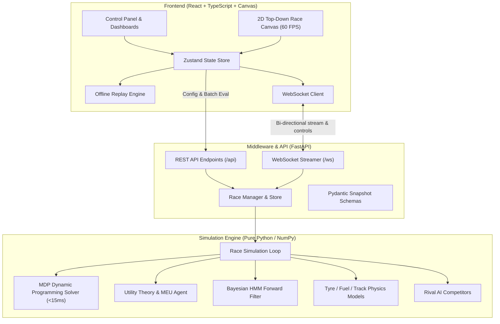

# 🏎️ The Impossible Pit Stop - Race Strategist AI

> An intelligent, autonomous race strategy simulation system powered by **Markov Decision Processes (MDP)**, **Utility Theory (MEU)**, and **Bayesian Belief Filtering (HMM)**.

[](file:///backend/tests)
[](file:///backend)
[](file:///frontend)
[](file:///backend/app)

---

## 📋 System Architecture



---

## 🎯 Design Decisions: Mapping Challenges to AI Solutions

| Problem Challenge | AI Mechanism Addressed | Technical Implementation |
| :--- | :--- | :--- |
| **Current vs Future Consequences** | **MDP Finite-Horizon Backward Induction** | Solves $V(s, t) = \min_a [C(s, a) + \mathbb{E}[V(s', t+1)]]$ backwards from lap $N$ to current lap, weighing the immediate pit transit loss against compounding tyre degradation savings across all future laps. |
| **Strategy Fails Under Other Conditions** | **Bayesian Belief-Driven Replanning** | The agent maintains a probability belief vector over weather states using an HMM forward update from noisy sensors. When the environment distribution shifts (TVD $> 0.35$), it re-solves the DP policy in $<15\text{ ms}$. |
| **Pit Stop Immediate Cost vs Long-Term Benefit** | **Utility Theory Decomposed Terms** | Decomposes action value into 6 transparent terms: $T_{\text{pit\_loss}}$, $\Delta_{\text{pace\_gain}}$, $\Delta_{\text{fuel\_weight}}$, $P_{\text{wear\_risk}}$, $P_{\text{traffic}}$, and $P_{\text{weather\_mismatch}}$. |
| **Random Stochastic Events** | **Probabilistic Reasoning & Monte Carlo Rollouts** | Models weather transitions as Markov chains, samples Safety Car / puncture risks from seeded distributions, and evaluates options against event probability expectations. |
| **Demonstrating Consistent Performance** | **Paired-Seed Batch Evaluation** | Evaluates strategies across $N$ races on identical seeds and scenarios, measuring win rates, mean time saved, and consistency scores ($CV = \sigma / \mu$). |

---

## 🚀 Quickstart & Setup Instructions

### 1. Prerequisites
- Python 3.10+
- Node.js v18+ & npm
- (Optional) Docker & Docker Compose

### 2. Running Locally

#### A. Backend (FastAPI + Engine)
```bash
cd backend
pip install -r requirements.txt
uvicorn app.main:app --host 127.0.0.1 --port 8000 --reload
```
API Documentation will be live at `http://127.0.0.1:8000/docs`.

#### B. Frontend (React + TypeScript + Canvas)
```bash
cd frontend
npm install
npm run dev
```
Open `http://localhost:3000` in your web browser.

#### C. Running the Headless CLI
```bash
# Single race run
python backend/cli.py --laps 50 --strategy mdp_agent --scenario changing_weather

# Multi-race batch comparison
python backend/cli.py --compare --runs 20 --laps 40 --export sample_data/cli_results.json
```

### 3. Docker Compose (One-Click Launch)
```bash
docker-compose up --build
```
- Frontend: `http://localhost:3000`
- Backend API: `http://localhost:8000`

---

## 🧪 Testing

Execute the comprehensive test suite (22 unit, integration, and performance tests):
```bash
python -m pytest backend/tests -v
```

---

## ⏱️ 3-Minute Demo Walkthrough Script

1. **Step 1: Normal Dry-Race Pit Stop**
   - Click **Play** or press <kbd>SPACE</kbd>. Watch the car circulate at high speed ($290\text{ km/h}$).
   - Around Lap 24, as tyre wear approaches the shaded cliff zone ($70\%$), the AI triggers `PIT_MEDIUM`.
   - Watch the car enter the pit lane, stop at Box 01, pit crew mechanics swarm in, tyres swap, fuel hose connects with the indicator rising, and a banner shows `"PIT STOP - Medium tyres, +32 kg fuel - 24.3 s"`.
2. **Step 2: Rain-Triggered Dynamic Replan**
   - In a changing weather scenario, observe the **Weather & Bayesian Belief** card.
   - As rain sensor readings arrive, the belief bar shifts from DRY to $85\%$ HEAVY_RAIN.
   - The AI triggers a **⚡ DYNAMIC REPLAN** banner, abandoning slicks immediately for `PIT_INTER` or `PIT_WET`, gaining $15\text{–}20\text{ s/lap}$ over cars stuck on slicks.
3. **Step 3: Safety Car Discount Exploitation**
   - When a Safety Car caution deploys (yellow glowing border and caution overlay), notice the pit stop net time loss is discounted by $10.5\text{ seconds}$.
   - The AI identifies this cheap stop window and boxes opportunistically.
4. **Step 4: The "i" Explanation Popover**
   - Click any small cyan **"i"** button next to **Decision**, **Lap Time**, **Fuel**, **Tyre Wear**, or **Weather Belief**.
   - Inspect the slide-out drawer displaying the exact mathematical formula, live numerical inputs, step-by-step arithmetic, final result, and plain-English explanation.
   - Review the **Why this decision?** ranked horizontal bar chart comparing candidate action Q-values.
5. **Step 5: Multi-Race Benchmark & Offline Mode**
   - In the **Strategy Comparison** card, click **Run 20-Race Eval** to simulate 20 paired-seed races across all scenarios.
   - Confirm that the `mdp_agent` achieves a $>90\%$ win-rate over the fixed baseline.
   - Toggle **Offline Demo Mode** or drag-and-drop `sample_data/snapshots_demo.json` to verify complete offline playback and telemetry scrubbing!
