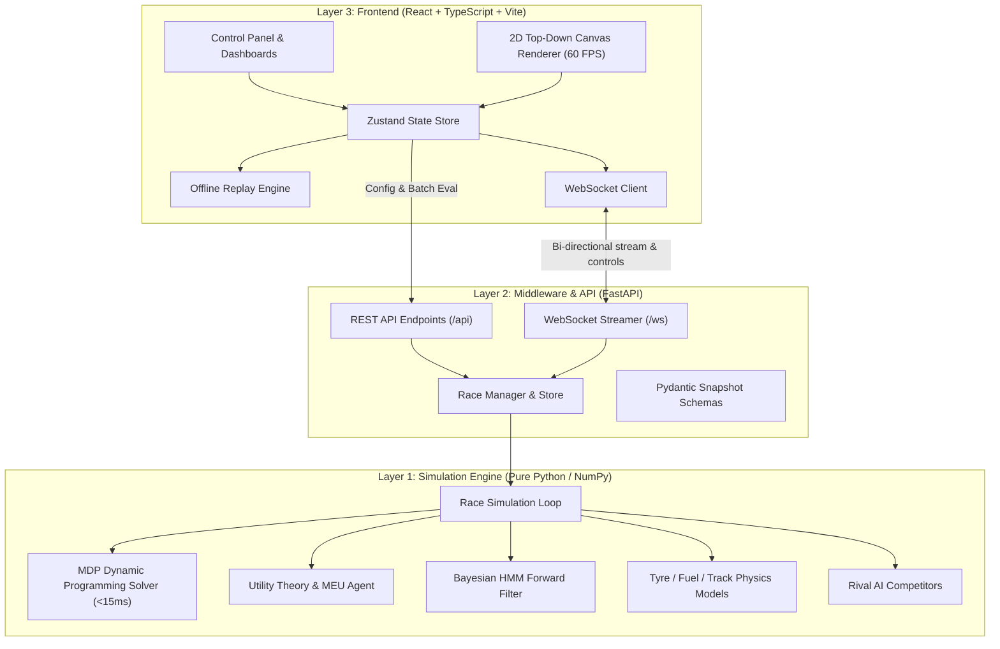

# System Architecture & Layer Responsibilities

The **Impossible Pit Stop - Race Strategist** is structured into three clean, decoupled layers adhering to clean architecture principles:

---

## 1. Engine Layer (`backend/engine/`)
- **Zero Web Dependencies**: Completely pure Python and NumPy. Can be executed headlessly from `cli.py` or imported in unit tests.
- **Physics Models**:
  - `tyres.py`: Compound specs (SOFT, MEDIUM, HARD, INTERMEDIATE, WET), thermal windows, quadratic wear degradation beyond the cliff.
  - `fuel.py`: Pace-adjusted fuel consumption, mass weight penalty ($0.033\text{ s/kg}$), refuelling rate.
  - `track.py`: 2D circuit spline control points, pit lane paths, distance-progress interpolation.
  - `lap_time.py`: Exact breakdown of constituent terms:
    $$\text{LapTime} = T_{\text{base}} + \Delta_{\text{compound}} + \Delta_{\text{wear}} + \Delta_{\text{fuel}} + \Delta_{\text{weather}} + \Delta_{\text{traffic}} + \Delta_{\text{pace}} + \text{Noise}$$
  - `pit_stop.py`: Transit time, stationary tyre change, parallel/sequential refuelling, Safety Car discount.
- **AI Decision Engines**:
  - `agent/mdp.py`: Finite-horizon dynamic programming backward induction solving in $<15\text{ ms}$.
  - `agent/utility.py`: Maximum Expected Utility (MEU) with 6 decomposed utility terms.
  - `agent/belief.py`: Bayesian forward filtering tracking weather posterior distributions.
  - `events.py`: Seeded stochastic events (Safety Car, VSC, Punctures, Engine penalties).

---

## 2. API & Middleware Layer (`backend/app/`)
- **FastAPI Core**:
  - REST endpoints for race creation, status retrieval, metadata listing, and batch evaluations.
  - WebSockets streaming lightweight tick updates ($20\text{ Hz}$) for fluid motion and comprehensive lap-level snapshots.
  - Bi-directional command listening (`play`, `pause`, `step`, `speed`, `reset`).
- **Single Source of Truth**:
  - Pydantic models in `schemas/snapshot.py` define the strict data contract mirrored in TypeScript (`frontend/src/types/snapshot.ts`).
- **In-Memory Store**:
  - Thread-safe repository decoupling simulation instances from HTTP transport.

---

## 3. Frontend Layer (`frontend/src/`)
- **2D HTML5 Canvas**:
  - Double-buffered rendering loop powered by `requestAnimationFrame`.
  - Offscreen canvas caching for the static track geometry.
  - Procedural car drawing with heading tangents, wheel rotation, and compound color rings.
  - Detailed pit stop animation: car drives into pit box, mechanics swarm, tyre swap burst, fuel hose pump animation, and countdown timer banner.
- **React + Zustand Dashboard**:
  - Split-screen layout (Left 38% details panel, Right 62% visual track and timeline).
  - Formula explanation popover drawer ("i" buttons) for step-by-step arithmetic verification.
  - Offline Replay mode supporting drag-and-drop loading of `snapshots.json`.
